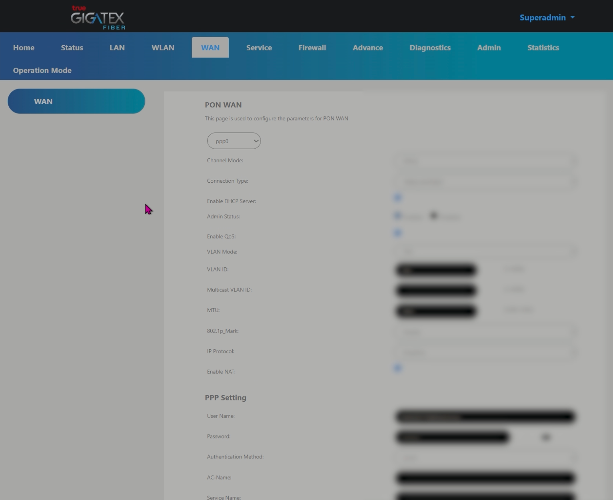
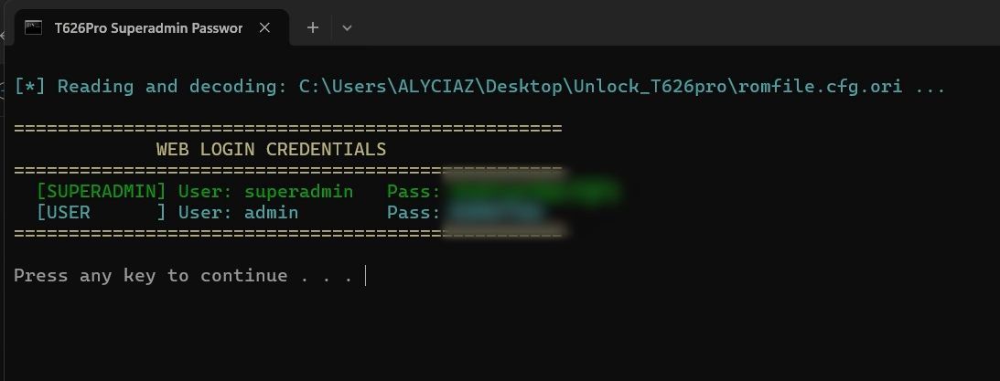

# True Router T626 Pro Superadmin Password Decoder

Offline decoder and credential extractor for **TrueOnline / Skyworth True Fiber T626 Pro** Wi-Fi 6 GPON ONT router configuration backups (`romfile.cfg`).

Extracts the router's dynamic **`superadmin`** and **`admin`** passwords without needing UART serial soldering, root access, or sending your backup file to third parties.

<p align="center">
  
</p>

---

## 📌 Why This Is Needed

In Thailand, TrueOnline provisions each **T626 Pro** router with a unique, randomized `superadmin` password. The standard user account (`admin`) printed on the router sticker is restricted from accessing critical configuration pages:
- **Bridge Mode** (WAN connection mode switching)
- **VLAN Binding / Port Isolation**
- **TR-069 ACS Settings**
- **SIP / VoIP Line Configuration**

Downloading the backup configuration file (`romfile.cfg`) via the Web GUI (`Maintenance -> Backup & Restore`) yields an obfuscated binary file. This tool reverses the proprietary obfuscation offline in milliseconds to reveal your cleartext login credentials.

<p align="center">
  
</p>

---

## 🚀 Quick Start

### Method 1: Windows Drag & Drop (Easiest)
1. Download or copy [`Superadmin.bat`](Superadmin.bat).
2. Download Backup file `romfile.cfg` from your router web interface tab Admin - Backup/Restore (`http://192.168.1.1`).
3. **Drag and drop** `romfile.cfg` directly onto `Superadmin.bat`.
4. Your `superadmin` and `admin` passwords will be displayed in the console window.

---

### Method 2: Native PowerShell (No Installation Required)
Open PowerShell in the folder containing your `romfile.cfg`:
```powershell
.\decode_t626pro.ps1
```
Or specify a custom path / export the full decrypted XML:
```powershell
.\decode_t626pro.ps1 -Path "C:\path\to\romfile.cfg" -OutputXml "decoded_config.xml"
```

---

### Method 3: Python 3 (Cross-Platform)
Works on Windows, macOS, and Linux without any external pip dependencies:
```bash
python decode_t626pro.py romfile.cfg
```
To export the full decrypted XML configuration:
```bash
python decode_t626pro.py romfile.cfg -o romfile_decrypted.xml
```

---

## 🖥️ Example Output

<p align="center">
  
</p>

```text
[*] Reading and decoding: romfile.cfg ...

==================================================
             WEB LOGIN CREDENTIALS
==================================================
  [SUPERADMIN] User: superadmin   Pass: xxxxxxxxxx
  [USER      ] User: admin        Pass: yyyyyyyyyy
==================================================
```

---

## 🔬 How the Encryption Works (Technical Analysis)

The proprietary obfuscation scheme was reverse-engineered from `/lib/libcfg_clisvc.so` (inside the `upgarde_fw` and `Base64_decode` functions) of the MediaTek/TrendChip ARM Linux firmware.

The process consists of two primary transformations:

```
[romfile.cfg] ──► (1. Stride Inversion & XOR) ──► (2. Custom Base64 Translate) ──► (3. Base64 Decode) ──► [XML Config]
```

### 1. 6-Byte Stride Inversion & Bitwise XOR
The binary is processed in 6-byte blocks (`r1 += 6`). Depending on `r1 % 9` and `r1 % 12`, selected bytes undergo bitwise XOR and complement inversion (`~`):

```python
r1 = 0
r8 = 3
while r1 < len(buf):
    if r1 % 9 == 0:
        buf[r1] = (~(buf[r1] ^ 0x75)) & 0xFF
        if r8 < len(buf):
            buf[r1 + 1] = (~(buf[r1 + 1] ^ 0x7B)) & 0xFF
            buf[r1 + 3] = (~(buf[r1 + 3] ^ 0x77)) & 0xFF
    elif r1 % 12 == 0:
        buf[r1] = (~(buf[r1] ^ 0x53)) & 0xFF
        if r8 < len(buf):
            buf[r1 + 1] = (~(buf[r1 + 1] ^ 0x77)) & 0xFF
            buf[r1 + 3] = (~(buf[r1 + 3] ^ 0x5B)) & 0xFF
    r1 += 6
    r8 += 6
```

### 2. Proprietary Scrambled Base64 Alphabet
After the inversion loop, the payload turns into an ASCII string encoded with a non-standard Base64 alphabet:

| Alphabet | Characters |
| :--- | :--- |
| **Custom (Firmware)** | `edcbaZYXWVUTSRQPONMLKJIHGFEDCBA+9876543210zyxwvutsrqponmlkjihgf/` |
| **Standard (RFC 4648)**| `ABCDEFGHIJKLMNOPQRSTUVWXYZabcdefghijklmnopqrstuvwxyz0123456789+/` |

The decoder maps each custom character back to the standard RFC 4648 alphabet and performs standard Base64 decoding, outputting the cleartext XML document (`<ROMFILE> ... </ROMFILE>`).

### 3. XML Node Extraction
The web credentials reside under the `<Account>` block in the decrypted XML:
```xml
<Account>
    <Entry0 username="superadmin" web_passwd="..." ... />
    <Entry1 username="admin" web_passwd="..." ... />
</Account>
```

---

## 📚 Credits & References

1. **[Blinko1987](https://github.com/Blinko1987)**
   - Author of the [True-Fiber-T626Pro-V1.0.0.5-Firmware](https://github.com/Blinko1987/True-Fiber-T626Pro-V1.0.0.5-Firmware) repository.
   - Provided the extracted True Fiber T626Pro V1.0.0.5 firmware dump and documented the hardware UART serial pinout and factory console credentials (`admin` / `$!%^kyw0rth`).

2. **Binary Reverse Engineering Analysis**
   - Disassembly and reverse-engineering of `/lib/libcfg_clisvc.so` (offsets `0x5af20` - `0x5b0c0`) and `/usr/bin/backuprestorecmd`.
   - Identification of the custom 64-character substitution cipher table and byte-stride modulo XOR operations.

---

## ⚖️ License

Distributed under the [MIT License](LICENSE). Free for personal and educational use.
